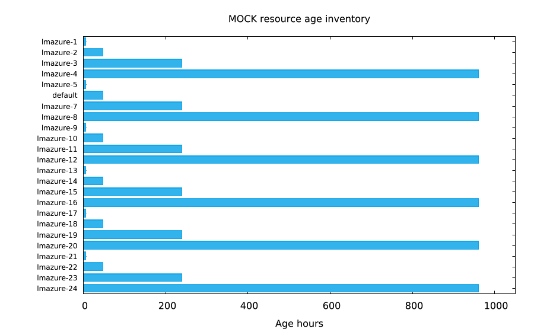
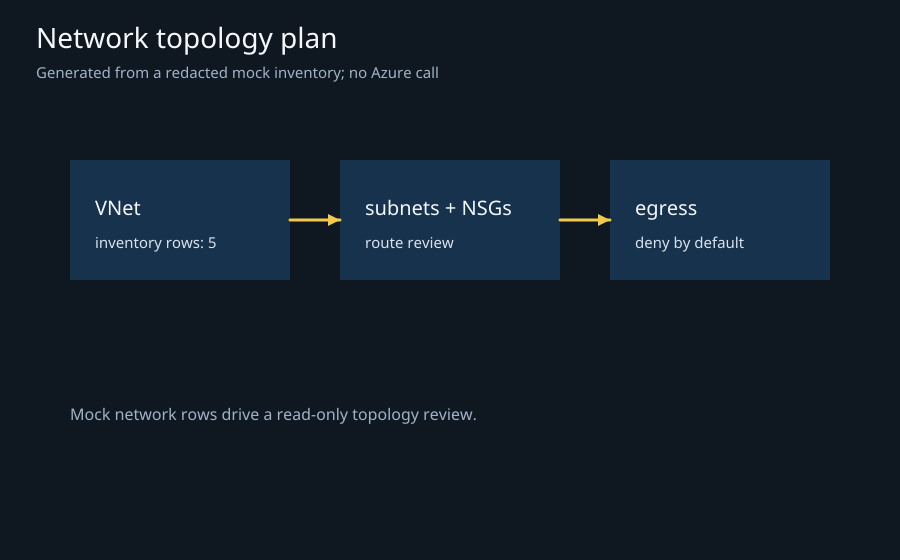
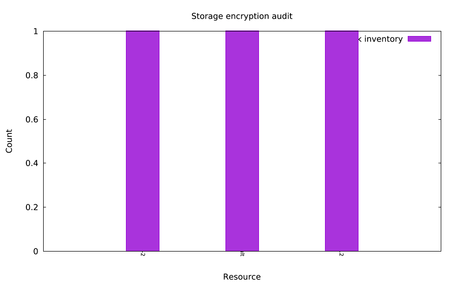
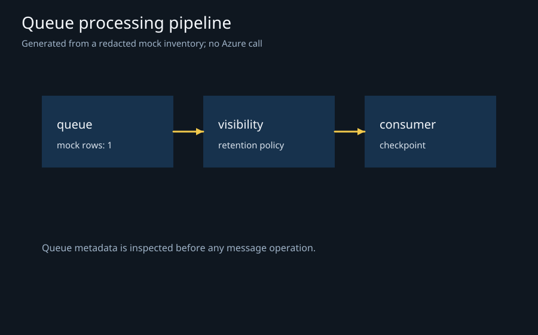
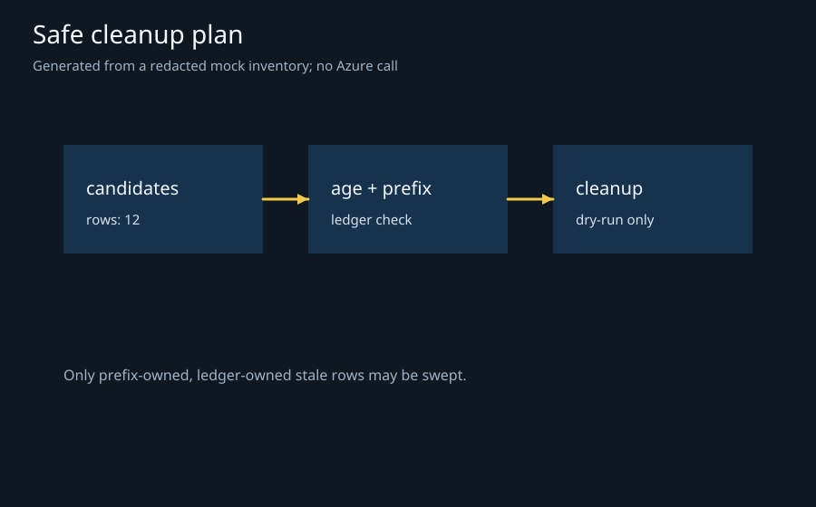

# lmazure

**A scriptable, safety-first Azure inventory and operations host for lmscript.**

| Resource inventory | Network topology plan | Security review |
| --- | --- | --- |
|  |  |  |
| Mock resources grouped by observed age horizon<br>`lmctl autorun https://raw.githubusercontent.com/lmctl-ai/lmazure/main/examples/resource_inventory.lms`<br>running this example costs about $0.00 (estimated from price table, not yet measured live) | Inventory → policy → dry-run action<br>`lmctl autorun https://raw.githubusercontent.com/lmctl-ai/lmazure/main/examples/network_topology.lms`<br>running this example costs about $0.00 (estimated from price table, not yet measured live) | A read-only audit path with an explicit action ledger<br>`lmctl autorun https://raw.githubusercontent.com/lmctl-ai/lmazure/main/examples/security_review.lms`<br>running this example costs about $0.00 (estimated from price table, not yet measured live) |

| Storage encryption | Queue pipeline | Cleanup plan |
| --- | --- | --- |
|  |  |  |
| Mock storage inventory for an encryption review<br>`lmctl autorun https://raw.githubusercontent.com/lmctl-ai/lmazure/main/examples/encryption_audit.lms`<br>running this example costs about $0.00 (estimated from price table, not yet measured live) | Queue resources flow through a tagged run ledger<br>`lmctl autorun https://raw.githubusercontent.com/lmctl-ai/lmazure/main/examples/queue_pipeline.lms`<br>running this example costs about $0.00 (estimated from price table, not yet measured live) | Dry-run, prefix, age, ledger, then explicit apply<br>`lmctl autorun https://raw.githubusercontent.com/lmctl-ai/lmazure/main/examples/cleanup_plan.lms`<br>running this example costs about $0.00 (estimated from price table, not yet measured live) |

## Quick start

The default examples use `mock()` and never contact Azure:

```sh
lmctl autorun https://raw.githubusercontent.com/lmctl-ai/lmazure/main/examples/resource_inventory.lms
```

The program writes a CSV beside its image. The mock fixture is deterministic, redacted, and varied enough to exercise inventory, security, tagging, age, regional, queue, serverless, and cleanup reports. No credentials or subscription identifiers are printed.

## Host API

Bind lmazure from lmscript with `_dsl_ cli="lmazure" install="github:lmctl-ai/lmazure@latest"`. The default path is `mock()`:

| API | Purpose |
| --- | --- |
| `mock()` | Deterministic in-process fixture; the only path used by the default gallery |
| `session.inventory(kind)` | Read-only tables for resources, compute, storage, network, identity, database, queues, serverless, monitoring, dns, vaults, or containers |
| `table.rows/columns/column/text/number/csv/json` | Inspect and export masked inventory rows |
| `session.begin_run(path)` | Create a prefixed run ledger for owned resources |
| `run.container(suffix)/queue(suffix)` | Create owned resources with an autogenerated `lmazure-<run-id>-...` prefix |
| `run.cost_cap(usd)` | Declare an estimate cap before creation: default $0.05, maximum $0.25 |
| `run.estimated_cost()/cost_report(path)` | Read the numeric estimate or export evidence, including after cleanup |
| `run.tag/delete/cleanup` | Tag, delete only ledger-owned resources, and clean up on failure |
| `session.sweep(path,hours)` | Dry-run stale-prefix sweep; use `sweep_apply` only after explicit opt-in |

The `live()` binding is gated by `LMAZURE_LIVE=1` and uses Azure `DefaultAzureCredential`. It is never called by CI or the examples in this README. A read-only live inventory is an explicit CLI operation: `lmazure --live --inventory resources`. Read [docs/LIVE_TESTING.md](docs/LIVE_TESTING.md) before enabling it.

## Examples

Every example is mock-only, self-executing, and has a copy-paste autorun command:

The 25 read-only mock examples print `estimated cost: $0.00`: they use no Azure credentials or billable calls. The two owned lifecycle examples print `estimated cost: $0.0005`, five request attempts × the conservative local planning allowance of $0.0001 per request; the fake run itself bills $0.00 and has not been measured live. Prices vary by region and time. Empty resources have a modeled time rate of zero; their lifetimes are still recorded. The default per-example cap is $0.05 and the hard whole-process ceiling is $0.25. Creation reserves teardown costs before HTTP dispatch. These are estimate admission limits, not a guaranteed maximum provider bill. See [cost calculation and evidence](docs/COSTS.md). CI has no Azure credentials, Azure login, or OIDC; it uses fake transports only.

| Example | Story | Autorun |
| --- | --- | --- |
| `resource_inventory.lms` | All resources — running this example costs about $0.00 (estimated from price table, not yet measured live) | `lmctl autorun https://raw.githubusercontent.com/lmctl-ai/lmazure/main/examples/resource_inventory.lms` |
| `compute_inventory.lms` | Compute — running this example costs about $0.00 (estimated from price table, not yet measured live) | `lmctl autorun https://raw.githubusercontent.com/lmctl-ai/lmazure/main/examples/compute_inventory.lms` |
| `storage_inventory.lms` | Storage — running this example costs about $0.00 (estimated from price table, not yet measured live) | `lmctl autorun https://raw.githubusercontent.com/lmctl-ai/lmazure/main/examples/storage_inventory.lms` |
| `network_inventory.lms` | Network — running this example costs about $0.00 (estimated from price table, not yet measured live) | `lmctl autorun https://raw.githubusercontent.com/lmctl-ai/lmazure/main/examples/network_inventory.lms` |
| `identity_inventory.lms` | Identity — running this example costs about $0.00 (estimated from price table, not yet measured live) | `lmctl autorun https://raw.githubusercontent.com/lmctl-ai/lmazure/main/examples/identity_inventory.lms` |
| `database_inventory.lms` | Databases — running this example costs about $0.00 (estimated from price table, not yet measured live) | `lmctl autorun https://raw.githubusercontent.com/lmctl-ai/lmazure/main/examples/database_inventory.lms` |
| `queue_inventory.lms` | Queues — running this example costs about $0.00 (estimated from price table, not yet measured live) | `lmctl autorun https://raw.githubusercontent.com/lmctl-ai/lmazure/main/examples/queue_inventory.lms` |
| `serverless_inventory.lms` | Serverless — running this example costs about $0.00 (estimated from price table, not yet measured live) | `lmctl autorun https://raw.githubusercontent.com/lmctl-ai/lmazure/main/examples/serverless_inventory.lms` |
| `monitoring_inventory.lms` | Monitoring — running this example costs about $0.00 (estimated from price table, not yet measured live) | `lmctl autorun https://raw.githubusercontent.com/lmctl-ai/lmazure/main/examples/monitoring_inventory.lms` |
| `dns_inventory.lms` | DNS — running this example costs about $0.00 (estimated from price table, not yet measured live) | `lmctl autorun https://raw.githubusercontent.com/lmctl-ai/lmazure/main/examples/dns_inventory.lms` |
| `vault_inventory.lms` | Vaults — running this example costs about $0.00 (estimated from price table, not yet measured live) | `lmctl autorun https://raw.githubusercontent.com/lmctl-ai/lmazure/main/examples/vault_inventory.lms` |
| `container_inventory.lms` | Containers — running this example costs about $0.00 (estimated from price table, not yet measured live) | `lmctl autorun https://raw.githubusercontent.com/lmctl-ai/lmazure/main/examples/container_inventory.lms` |
| `public_resource_audit.lms` | Public exposure — running this example costs about $0.00 (estimated from price table, not yet measured live) | `lmctl autorun https://raw.githubusercontent.com/lmctl-ai/lmazure/main/examples/public_resource_audit.lms` |
| `encryption_audit.lms` | Encryption — running this example costs about $0.00 (estimated from price table, not yet measured live) | `lmctl autorun https://raw.githubusercontent.com/lmctl-ai/lmazure/main/examples/encryption_audit.lms` |
| `tagging_compliance.lms` | Tag coverage — running this example costs about $0.00 (estimated from price table, not yet measured live) | `lmctl autorun https://raw.githubusercontent.com/lmctl-ai/lmazure/main/examples/tagging_compliance.lms` |
| `stale_resources.lms` | Stale resources — running this example costs about $0.00 (estimated from price table, not yet measured live) | `lmctl autorun https://raw.githubusercontent.com/lmctl-ai/lmazure/main/examples/stale_resources.lms` |
| `regional_footprint.lms` | Regions — running this example costs about $0.00 (estimated from price table, not yet measured live) | `lmctl autorun https://raw.githubusercontent.com/lmctl-ai/lmazure/main/examples/regional_footprint.lms` |
| `resource_status.lms` | Observed metadata status (not VM health) — running this example costs about $0.00 (estimated from price table, not yet measured live) | `lmctl autorun https://raw.githubusercontent.com/lmctl-ai/lmazure/main/examples/resource_status.lms` |
| `age_distribution.lms` | Resource age — running this example costs about $0.00 (estimated from price table, not yet measured live) | `lmctl autorun https://raw.githubusercontent.com/lmctl-ai/lmazure/main/examples/age_distribution.lms` |
| `service_counts.lms` | Service overview — running this example costs about $0.00 (estimated from price table, not yet measured live) | `lmctl autorun https://raw.githubusercontent.com/lmctl-ai/lmazure/main/examples/service_counts.lms` |
| `network_topology.lms` | Network plan — running this example costs about $0.00 (estimated from price table, not yet measured live) | `lmctl autorun https://raw.githubusercontent.com/lmctl-ai/lmazure/main/examples/network_topology.lms` |
| `security_review.lms` | Security workflow — running this example costs about $0.00 (estimated from price table, not yet measured live) | `lmctl autorun https://raw.githubusercontent.com/lmctl-ai/lmazure/main/examples/security_review.lms` |
| `queue_pipeline.lms` | Queue workflow — running this example costs about $0.00 (estimated from price table, not yet measured live) | `lmctl autorun https://raw.githubusercontent.com/lmctl-ai/lmazure/main/examples/queue_pipeline.lms` |
| `cleanup_plan.lms` | Safe cleanup — running this example costs about $0.00 (estimated from price table, not yet measured live) | `lmctl autorun https://raw.githubusercontent.com/lmctl-ai/lmazure/main/examples/cleanup_plan.lms` |
| `serverless_plan.lms` | Serverless release — running this example costs about $0.00 (estimated from price table, not yet measured live) | `lmctl autorun https://raw.githubusercontent.com/lmctl-ai/lmazure/main/examples/serverless_plan.lms` |
| `owned_container_cycle.lms` | Owned container create, tag, cleanup — running this example costs about $0.0005 (estimated from price table, not yet measured live) · [fake ledger](evidence/fake-cost-owned_container_cycle-fbcd7ca8646d.json) | `lmctl autorun https://raw.githubusercontent.com/lmctl-ai/lmazure/main/examples/owned_container_cycle.lms` |
| `owned_queue_cycle.lms` | Owned queue create, tag, cleanup — running this example costs about $0.0005 (estimated from price table, not yet measured live) · [fake ledger](evidence/fake-cost-owned_queue_cycle-2076aa34d5f5.json) | `lmctl autorun https://raw.githubusercontent.com/lmctl-ai/lmazure/main/examples/owned_queue_cycle.lms` |

## Build and test

```sh
bash test.sh
scripts/build-native.sh
PATH="$PWD/artifacts/native:$PATH" LMAZURE_LMSCRIPT=lmscript python3 scripts/test-examples.py
```

Building requires the pinned .NET 10.0.402 SDK and Python 3. Linux also needs clang, CMake, OpenSSL and zlib development archives. Release executables need no .NET installation. Linux requires glibc 2.35 or newer; OpenSSL, zlib and compiler runtimes are static.

See [the package-by-package NativeAOT checks](docs/AOT.md) and [the user-run live test](docs/LIVE_TESTING.md).

The curated inventory is ARM resource metadata. Generic listings do not establish live public-access or encryption settings: unavailable values are reported as unknown. Resource names are retained; exported resource identifiers are masked. The gallery illustrates synthetic data and has never accessed a real subscription.

## Resource limits

`LMAZURE_MAX_MEMORY_MB` sets a managed allocation budget, default 4096 MiB. Invalid or non-positive values exit 2; an exhausted or unusably small positive budget exits 3. The host checks allocation progress every 1024 VM instructions and caps the managed heap at startup. Native allocations, runtime setup and OS buffers add overhead; this is not an RSS quota. Azure responses are limited to 8 MiB, inventory visits to 10,000 resources, and runs to 16 owned resources. SDK retries are disabled and requests have bounded timeouts.
