# lmazure

**A scriptable Azure metadata and owned-resource host for lmscript — 72 illustrated examples.**

| Service Bus | Service counts by region | Regional ownership graph |
| --- | --- | --- |
| 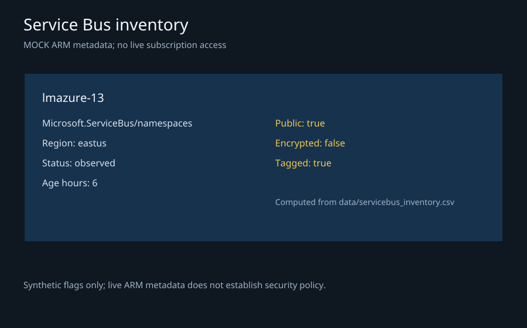 | 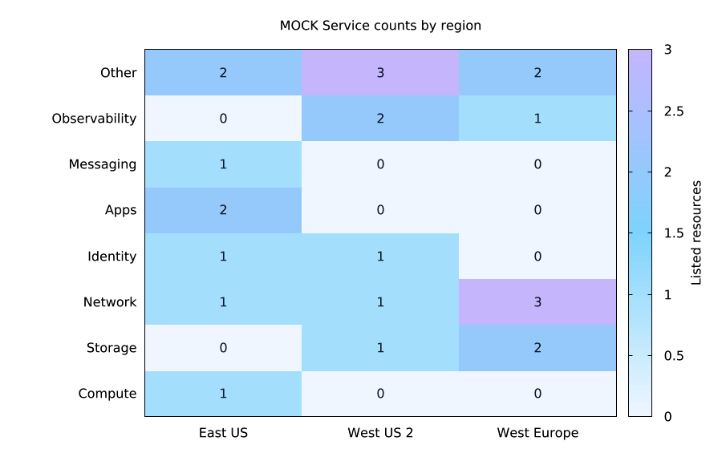 | 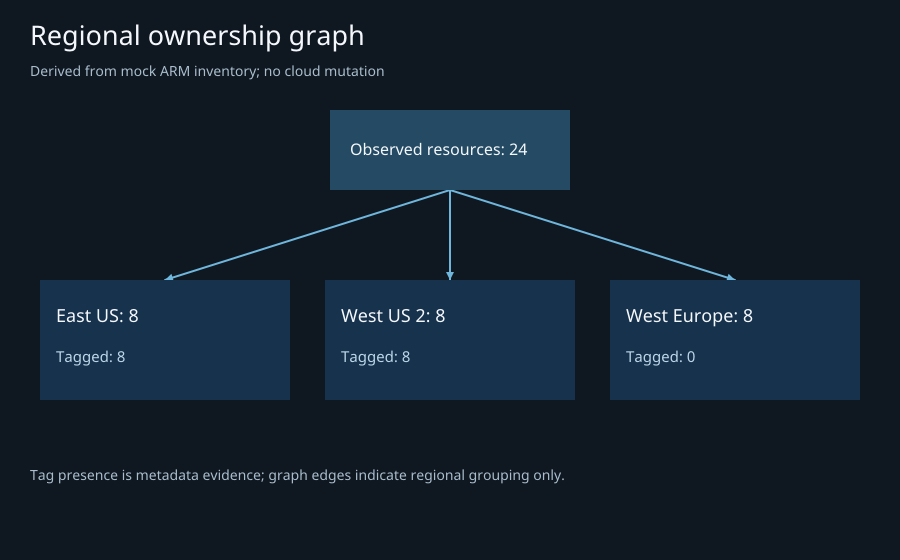 |
| `lmctl https://raw.githubusercontent.com/lmctl-ai/lmazure/main/examples/servicebus_inventory.lms`<br>running this example costs about $0.00 (estimated from price table, not yet measured live) | `lmctl https://raw.githubusercontent.com/lmctl-ai/lmazure/main/examples/region_service_matrix.lms`<br>running this example costs about $0.00 (estimated from price table, not yet measured live) | `lmctl https://raw.githubusercontent.com/lmctl-ai/lmazure/main/examples/regional_resource_graph.lms`<br>running this example costs about $0.00 (estimated from price table, not yet measured live) |

| Functions | Owned Mixed Lifecycle | Cost Request Breakdown |
| --- | --- | --- |
| 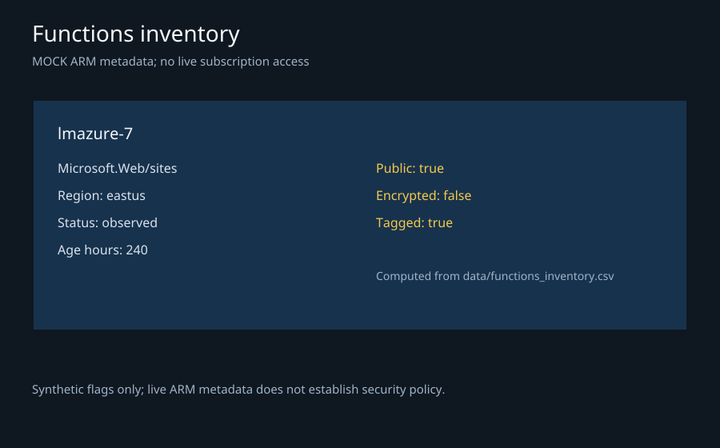 | 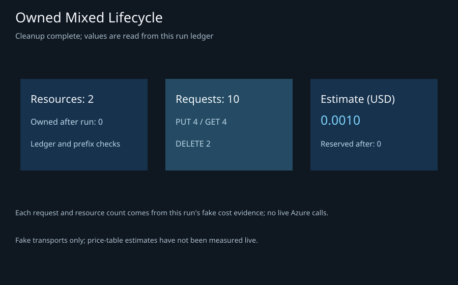 | 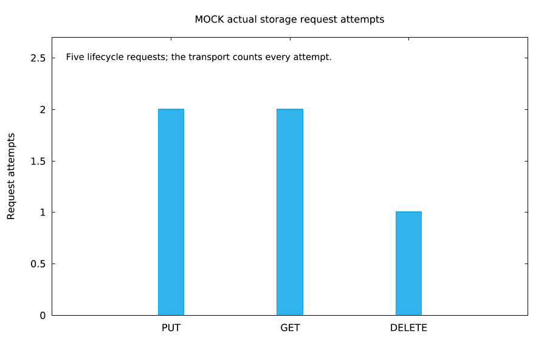 |
| `lmctl https://raw.githubusercontent.com/lmctl-ai/lmazure/main/examples/functions_inventory.lms`<br>running this example costs about $0.00 (estimated from price table, not yet measured live) | `lmctl https://raw.githubusercontent.com/lmctl-ai/lmazure/main/examples/owned_mixed_lifecycle.lms`<br>running this example costs about $0.0010 (estimated from price table, not yet measured live) | `lmctl https://raw.githubusercontent.com/lmctl-ai/lmazure/main/examples/cost_request_breakdown.lms`<br>running this example costs about $0.0005 (estimated from price table, not yet measured live) |

## Quick start

The default examples use `mock()` and never contact Azure:

```sh
lmctl https://raw.githubusercontent.com/lmctl-ai/lmazure/main/examples/resource_inventory.lms
```

The program writes a CSV beside its image. The mock fixture is deterministic, redacted, and varied enough to exercise inventory, security, tagging, age, regional, queue, serverless, and cleanup reports. No credentials or subscription identifiers are printed.

## Native SDK versus lmcloud

All 72 examples also have self-contained [lmcloud/OpenTofu equivalents](compare/README.md), a small AzureRM configuration, and a [comparison results table](compare/RESULTS.md). Run `compare/run.sh <example>` for the offline comparison. It checks exact created resource names/types, ownership metadata and fingerprints, common outputs, wall time, estimated cost and zero cleanup leftovers. Offline fixture agreement is explicitly separated from AzureRM behavior; every live comparison remains pending user test. The lmcloud repository is not modified.

**[v0.1.4](https://github.com/lmctl-ai/lmazure/releases/tag/v0.1.4) — READY TO TEST.** The live report uses one approval field and requires matching actual-provider results and zero leftovers before live status can be “same.” Managed/native checks, all 72 local gallery runs and all 72 offline comparisons passed; the five-platform release published and all five asset hashes were verified. [Current verification](durable-memory/10-live-report-fix.md) records the fake handoff regressions; [v0.1.3 baseline evidence](durable-memory/v0.1.3-verification.json) retains the fresh-cache public-URL checks. [lmcloud findings](compare/LMCLOUD_ISSUES.md) describe provider limits. Live AzureRM comparisons remain pending user test.

## Host API

Bind lmazure from lmscript with `_dsl_ cli="lmazure" install="github:lmctl-ai/lmazure@latest"`. The default path is `mock()`:

| API | Purpose |
| --- | --- |
| `mock()` | Deterministic in-process fixture; the only path used by the default gallery |
| `session.inventory(kind)` | Read-only tables for resources, compute, storage, network, identity, database, queues, serverless, monitoring, dns, vaults, or containers |
| `table.rows/columns/column/text/number/csv/json` | Inspect and export masked inventory rows |
| `session.readonly_cost_report(path)` | Export a zero-cost metadata ledger with measured ARM request count |
| `session.begin_run(path)` | Create a prefixed run ledger for owned resources |
| `run.container(suffix)/queue(suffix)` | Create owned resources with an autogenerated `lmazure-<run-id>-...` prefix |
| `run.cost_cap(usd)` | Declare an estimate cap before creation: default $0.05, maximum $0.25 |
| `run.estimated_cost()/cost_report(path)` | Read the numeric estimate or export evidence, including after cleanup |
| `run.tag/delete/cleanup` | Tag, delete only ledger-owned resources, and clean up on failure |
| `session.sweep(path,hours)` | Dry-run stale-prefix sweep; use `sweep_apply` only after explicit opt-in |

The `live()` binding is gated by `LMAZURE_LIVE=1` and uses Azure `DefaultAzureCredential`. It is never called by CI or the examples in this README. A read-only live inventory is an explicit CLI operation: `lmazure --live --inventory resources`. Read [docs/LIVE_TESTING.md](docs/LIVE_TESTING.md) before enabling it.

## Curated service coverage

There are **72 self-contained examples**, each with an image, cost evidence, and a final estimate line. All use in-process fakes; no real subscription has been tested. Metadata inventory covers compute, storage accounts and queues, VNet/NSG/public IP/routes/DNS, managed identities, SQL/PostgreSQL/Cosmos, Functions/App Service plans, Service Bus namespaces, Application Insights/alerts/log workspaces, Key Vault, AKS, ACR and backup vaults.

These are ARM metadata views: NSG inventory does not evaluate firewall rules; Functions inventory does not invoke code; Service Bus inventory does not read messages or create namespaces; monitoring examples do not run charged log queries. Graph edges show explicit inventory grouping, not inferred application dependencies. Public/encryption facts unavailable from live ARM metadata remain unknown. Mutation examples create only empty, run-owned containers/queues with the `lmazure-` prefix and `lmazure_test` metadata; they retain a ledger, reserve teardown, and leave zero owned resources after cleanup.

The examples use 55 zero-cost metadata ledgers, 16 owned lifecycle ledgers, and one zero-cost budget rejection. Every displayed amount is estimated from the price table, not yet measured live. Prices vary by region and time; see [the cost model](docs/COSTS.md).

## Build and test

```sh
bash test.sh
scripts/build-native.sh
PATH="$PWD/artifacts/native:$PATH" LMAZURE_LMSCRIPT=lmscript python3 scripts/test-examples.py
```

Building requires the pinned .NET 10.0.402 SDK and Python 3. Linux also needs clang, CMake, OpenSSL and zlib development archives. Release executables need no .NET installation. Linux requires glibc 2.35 or newer; OpenSSL, zlib and compiler runtimes are static.

See [the package-by-package NativeAOT checks](docs/AOT.md) and [the user-run live test](docs/LIVE_TESTING.md).

The curated inventory is ARM resource metadata. Generic listings do not establish live public-access or encryption settings: unavailable values are reported as unknown. Resource names are retained; exported resource identifiers are masked. The gallery illustrates synthetic data and has never accessed a real subscription.

## Resource limits

`LMAZURE_MAX_MEMORY_MB` sets a managed allocation budget, default 4096 MiB. Invalid or non-positive values exit 2; an exhausted or unusably small positive budget exits 3. The host checks allocation progress every 1024 VM instructions and caps the managed heap at startup. Native allocations, runtime setup and OS buffers add overhead; this is not an RSS quota. Azure responses are limited to 8 MiB, inventory visits to 10,000 resources, and runs to 16 owned resources. SDK retries are disabled and requests have bounded timeouts.

## Complete illustrated catalog

Each picture is generated by its matching program. All captions use the raw autorun URL; the cost is a fake-transport planning estimate, not a live billing measurement. Actual Azure charge for these mock examples is $0.00.

### Inventory and baseline audits

| Picture | Example, estimate and autorun |
| --- | --- |
| 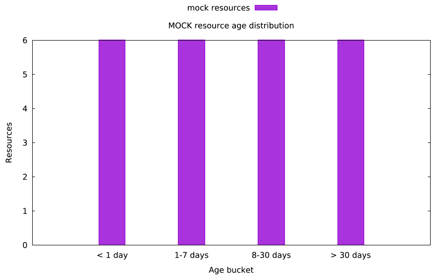 | **Age distribution** — running this example costs about $0.00 (estimated from price table, not yet measured live)<br>`lmctl https://raw.githubusercontent.com/lmctl-ai/lmazure/main/examples/age_distribution.lms` |
|  | **Cleanup plan** — running this example costs about $0.00 (estimated from price table, not yet measured live)<br>`lmctl https://raw.githubusercontent.com/lmctl-ai/lmazure/main/examples/cleanup_plan.lms` |
|  | **Compute inventory** — running this example costs about $0.00 (estimated from price table, not yet measured live)<br>`lmctl https://raw.githubusercontent.com/lmctl-ai/lmazure/main/examples/compute_inventory.lms` |
| 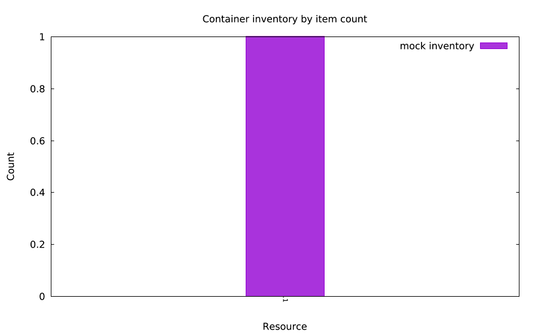 | **Container inventory** — running this example costs about $0.00 (estimated from price table, not yet measured live)<br>`lmctl https://raw.githubusercontent.com/lmctl-ai/lmazure/main/examples/container_inventory.lms` |
|  | **Database inventory** — running this example costs about $0.00 (estimated from price table, not yet measured live)<br>`lmctl https://raw.githubusercontent.com/lmctl-ai/lmazure/main/examples/database_inventory.lms` |
| 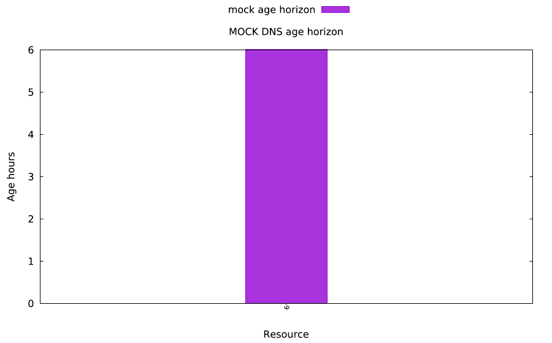 | **Dns inventory** — running this example costs about $0.00 (estimated from price table, not yet measured live)<br>`lmctl https://raw.githubusercontent.com/lmctl-ai/lmazure/main/examples/dns_inventory.lms` |
|  | **Encryption audit** — running this example costs about $0.00 (estimated from price table, not yet measured live)<br>`lmctl https://raw.githubusercontent.com/lmctl-ai/lmazure/main/examples/encryption_audit.lms` |
|  | **Identity inventory** — running this example costs about $0.00 (estimated from price table, not yet measured live)<br>`lmctl https://raw.githubusercontent.com/lmctl-ai/lmazure/main/examples/identity_inventory.lms` |
| 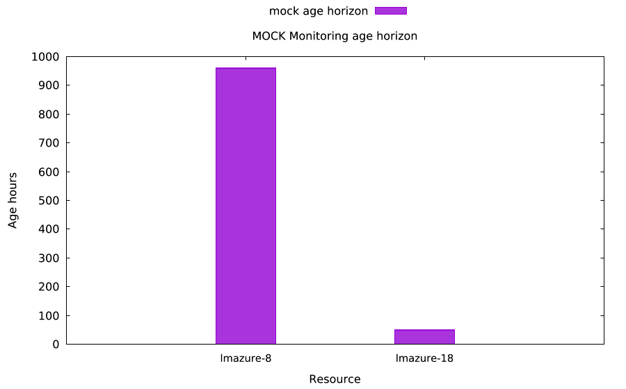 | **Monitoring inventory** — running this example costs about $0.00 (estimated from price table, not yet measured live)<br>`lmctl https://raw.githubusercontent.com/lmctl-ai/lmazure/main/examples/monitoring_inventory.lms` |
| 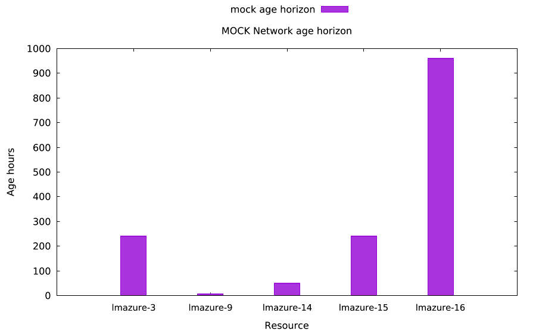 | **Network inventory** — running this example costs about $0.00 (estimated from price table, not yet measured live)<br>`lmctl https://raw.githubusercontent.com/lmctl-ai/lmazure/main/examples/network_inventory.lms` |
|  | **Network topology** — running this example costs about $0.00 (estimated from price table, not yet measured live)<br>`lmctl https://raw.githubusercontent.com/lmctl-ai/lmazure/main/examples/network_topology.lms` |
| 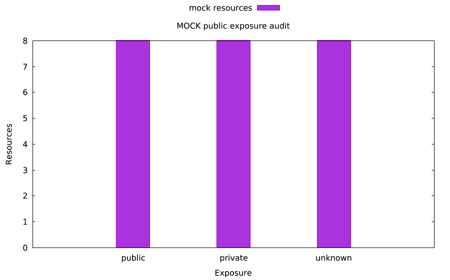 | **Public resource audit** — running this example costs about $0.00 (estimated from price table, not yet measured live)<br>`lmctl https://raw.githubusercontent.com/lmctl-ai/lmazure/main/examples/public_resource_audit.lms` |
| 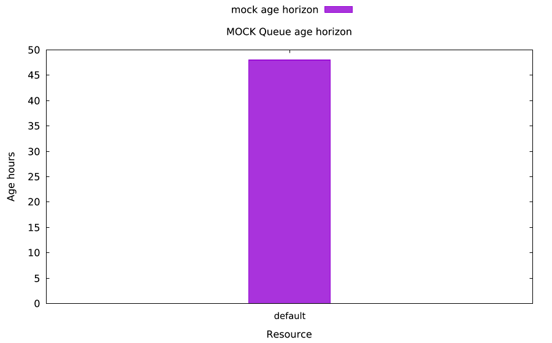 | **Queue inventory** — running this example costs about $0.00 (estimated from price table, not yet measured live)<br>`lmctl https://raw.githubusercontent.com/lmctl-ai/lmazure/main/examples/queue_inventory.lms` |
|  | **Queue pipeline** — running this example costs about $0.00 (estimated from price table, not yet measured live)<br>`lmctl https://raw.githubusercontent.com/lmctl-ai/lmazure/main/examples/queue_pipeline.lms` |
| 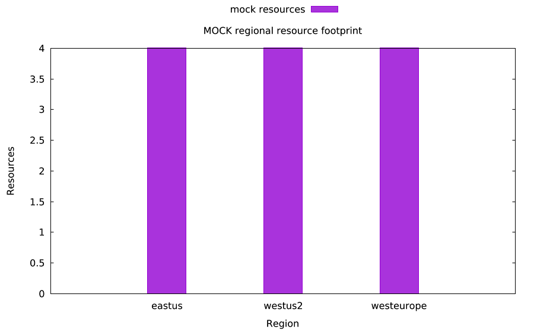 | **Regional footprint** — running this example costs about $0.00 (estimated from price table, not yet measured live)<br>`lmctl https://raw.githubusercontent.com/lmctl-ai/lmazure/main/examples/regional_footprint.lms` |
|  | **Resource inventory** — running this example costs about $0.00 (estimated from price table, not yet measured live)<br>`lmctl https://raw.githubusercontent.com/lmctl-ai/lmazure/main/examples/resource_inventory.lms` |
| 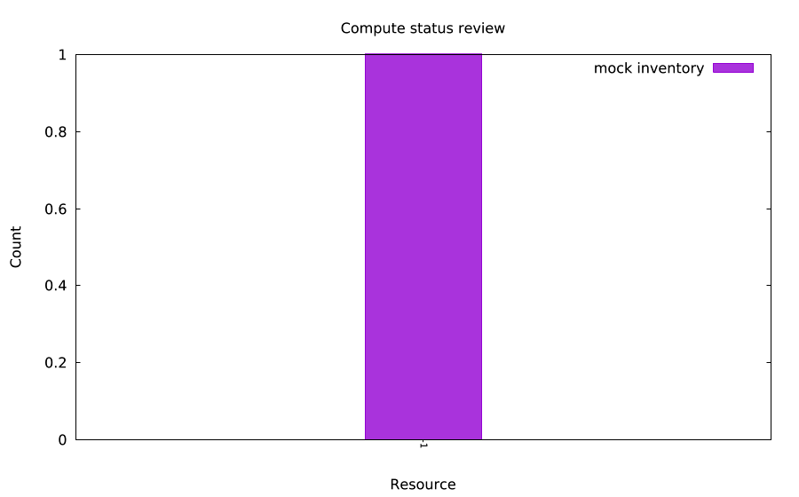 | **Resource status** — running this example costs about $0.00 (estimated from price table, not yet measured live)<br>`lmctl https://raw.githubusercontent.com/lmctl-ai/lmazure/main/examples/resource_status.lms` |
|  | **Security review** — running this example costs about $0.00 (estimated from price table, not yet measured live)<br>`lmctl https://raw.githubusercontent.com/lmctl-ai/lmazure/main/examples/security_review.lms` |
|  | **Serverless inventory** — running this example costs about $0.00 (estimated from price table, not yet measured live)<br>`lmctl https://raw.githubusercontent.com/lmctl-ai/lmazure/main/examples/serverless_inventory.lms` |
| 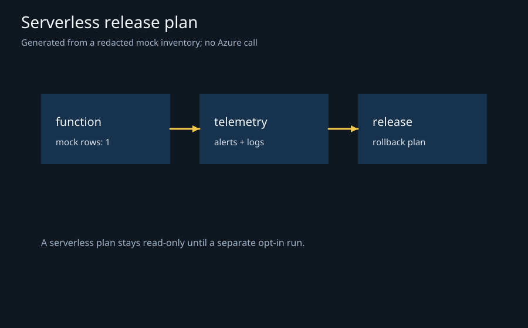 | **Serverless plan** — running this example costs about $0.00 (estimated from price table, not yet measured live)<br>`lmctl https://raw.githubusercontent.com/lmctl-ai/lmazure/main/examples/serverless_plan.lms` |
| 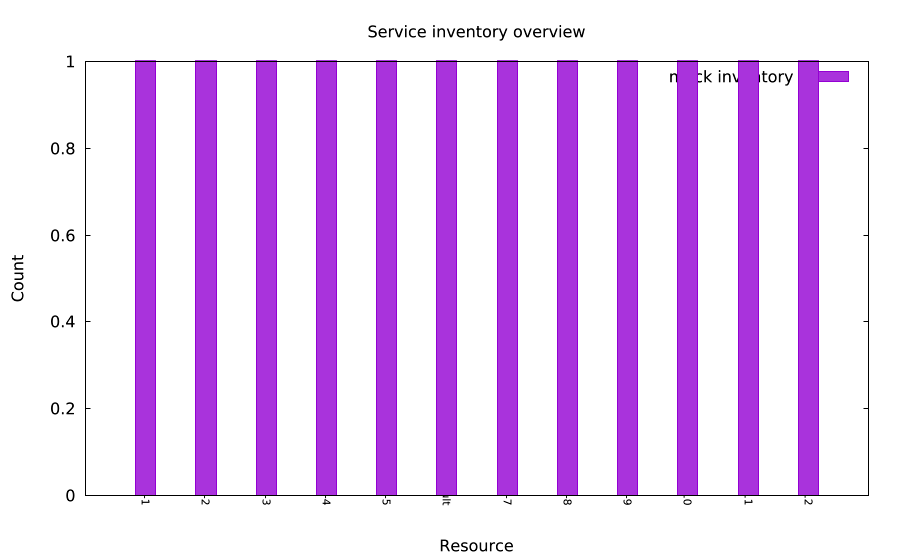 | **Service counts** — running this example costs about $0.00 (estimated from price table, not yet measured live)<br>`lmctl https://raw.githubusercontent.com/lmctl-ai/lmazure/main/examples/service_counts.lms` |
| 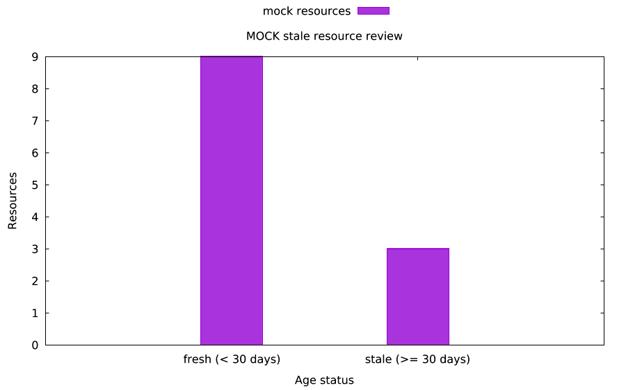 | **Stale resources** — running this example costs about $0.00 (estimated from price table, not yet measured live)<br>`lmctl https://raw.githubusercontent.com/lmctl-ai/lmazure/main/examples/stale_resources.lms` |
| 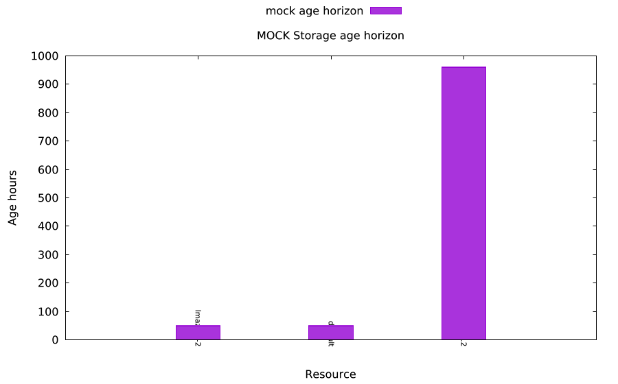 | **Storage inventory** — running this example costs about $0.00 (estimated from price table, not yet measured live)<br>`lmctl https://raw.githubusercontent.com/lmctl-ai/lmazure/main/examples/storage_inventory.lms` |
| 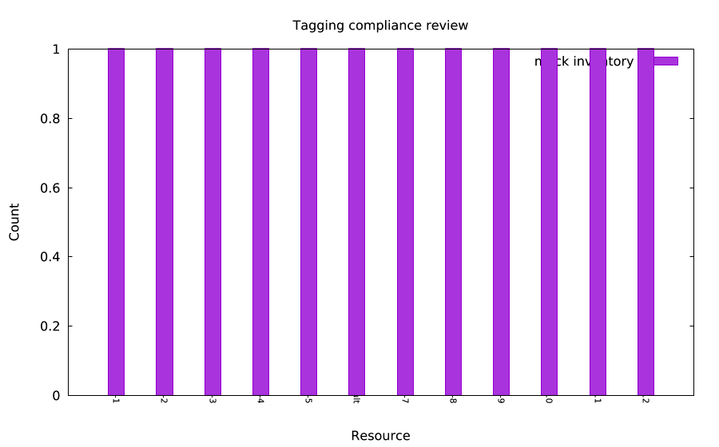 | **Tagging compliance** — running this example costs about $0.00 (estimated from price table, not yet measured live)<br>`lmctl https://raw.githubusercontent.com/lmctl-ai/lmazure/main/examples/tagging_compliance.lms` |
| 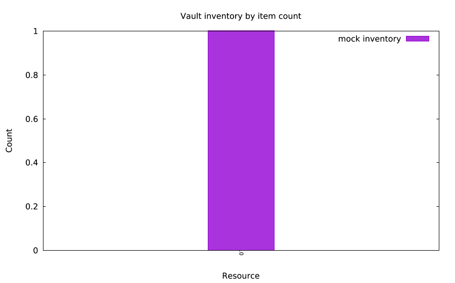 | **Vault inventory** — running this example costs about $0.00 (estimated from price table, not yet measured live)<br>`lmctl https://raw.githubusercontent.com/lmctl-ai/lmazure/main/examples/vault_inventory.lms` |

### Curated service metadata

| Picture | Example, estimate and autorun |
| --- | --- |
|  | **Functions** — running this example costs about $0.00 (estimated from price table, not yet measured live)<br>`lmctl https://raw.githubusercontent.com/lmctl-ai/lmazure/main/examples/functions_inventory.lms` |
|  | **Service Bus** — running this example costs about $0.00 (estimated from price table, not yet measured live)<br>`lmctl https://raw.githubusercontent.com/lmctl-ai/lmazure/main/examples/servicebus_inventory.lms` |
| 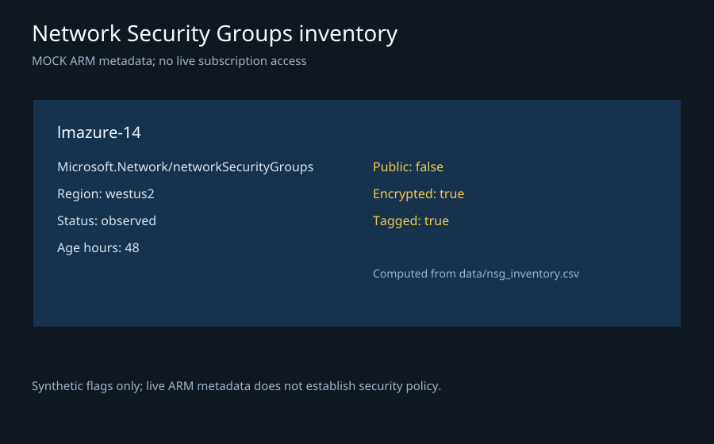 | **Network Security Groups** — running this example costs about $0.00 (estimated from price table, not yet measured live)<br>`lmctl https://raw.githubusercontent.com/lmctl-ai/lmazure/main/examples/nsg_inventory.lms` |
| 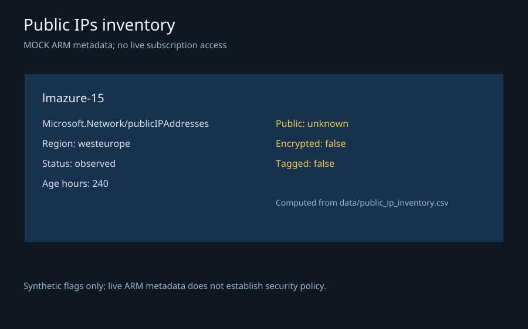 | **Public IPs** — running this example costs about $0.00 (estimated from price table, not yet measured live)<br>`lmctl https://raw.githubusercontent.com/lmctl-ai/lmazure/main/examples/public_ip_inventory.lms` |
| 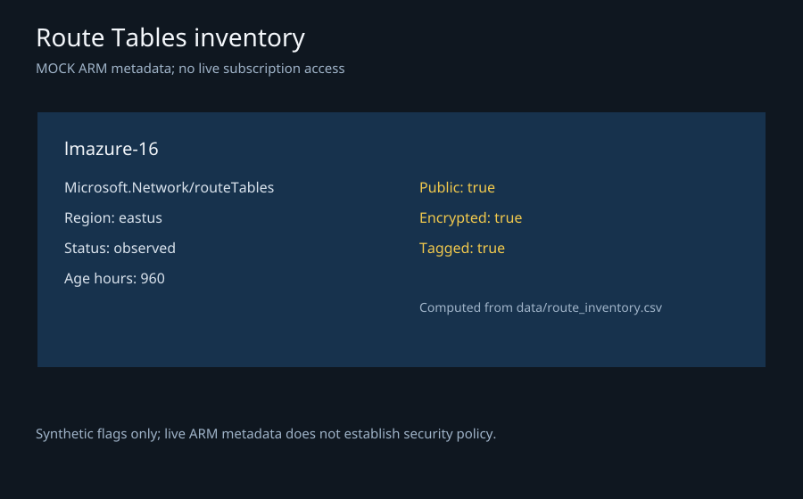 | **Route Tables** — running this example costs about $0.00 (estimated from price table, not yet measured live)<br>`lmctl https://raw.githubusercontent.com/lmctl-ai/lmazure/main/examples/route_inventory.lms` |
| 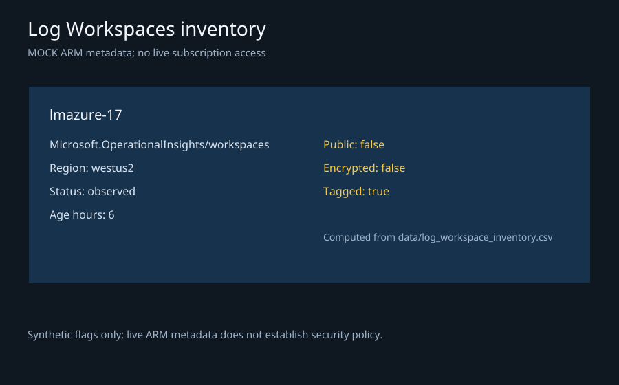 | **Log Workspaces** — running this example costs about $0.00 (estimated from price table, not yet measured live)<br>`lmctl https://raw.githubusercontent.com/lmctl-ai/lmazure/main/examples/log_workspace_inventory.lms` |
| 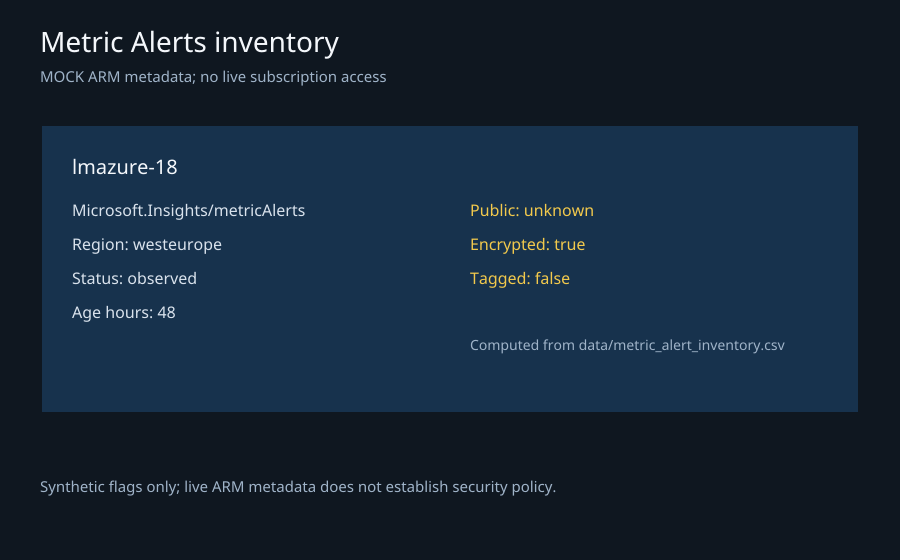 | **Metric Alerts** — running this example costs about $0.00 (estimated from price table, not yet measured live)<br>`lmctl https://raw.githubusercontent.com/lmctl-ai/lmazure/main/examples/metric_alert_inventory.lms` |
| 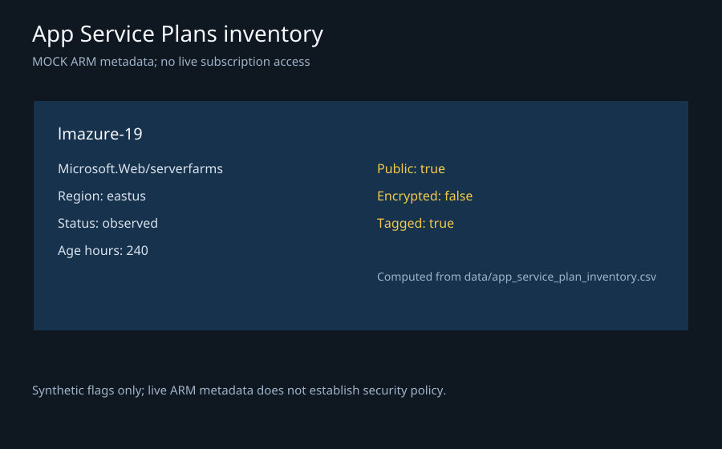 | **App Service Plans** — running this example costs about $0.00 (estimated from price table, not yet measured live)<br>`lmctl https://raw.githubusercontent.com/lmctl-ai/lmazure/main/examples/app_service_plan_inventory.lms` |
| 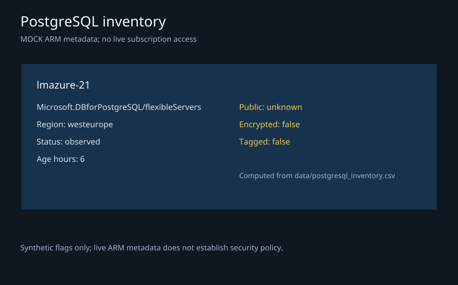 | **PostgreSQL** — running this example costs about $0.00 (estimated from price table, not yet measured live)<br>`lmctl https://raw.githubusercontent.com/lmctl-ai/lmazure/main/examples/postgresql_inventory.lms` |
| 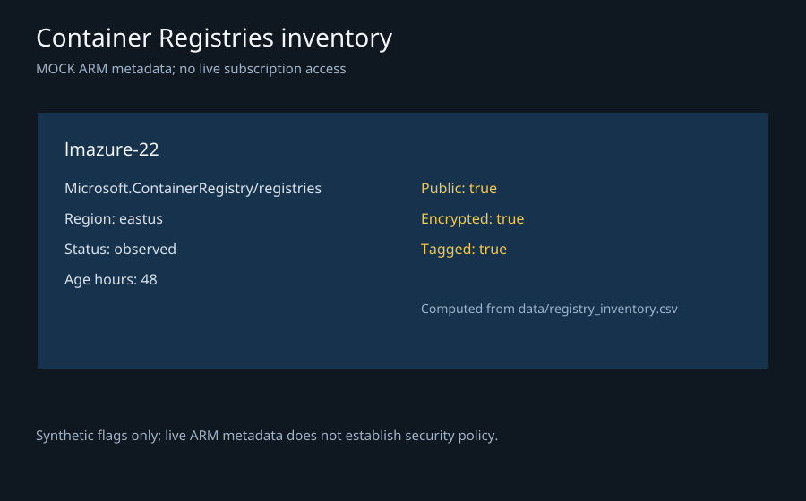 | **Container Registries** — running this example costs about $0.00 (estimated from price table, not yet measured live)<br>`lmctl https://raw.githubusercontent.com/lmctl-ai/lmazure/main/examples/registry_inventory.lms` |
| 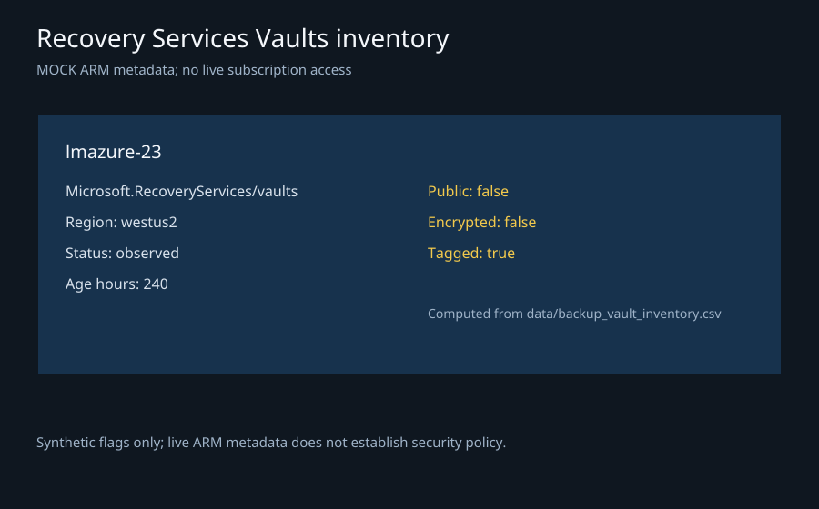 | **Recovery Services Vaults** — running this example costs about $0.00 (estimated from price table, not yet measured live)<br>`lmctl https://raw.githubusercontent.com/lmctl-ai/lmazure/main/examples/backup_vault_inventory.lms` |
| 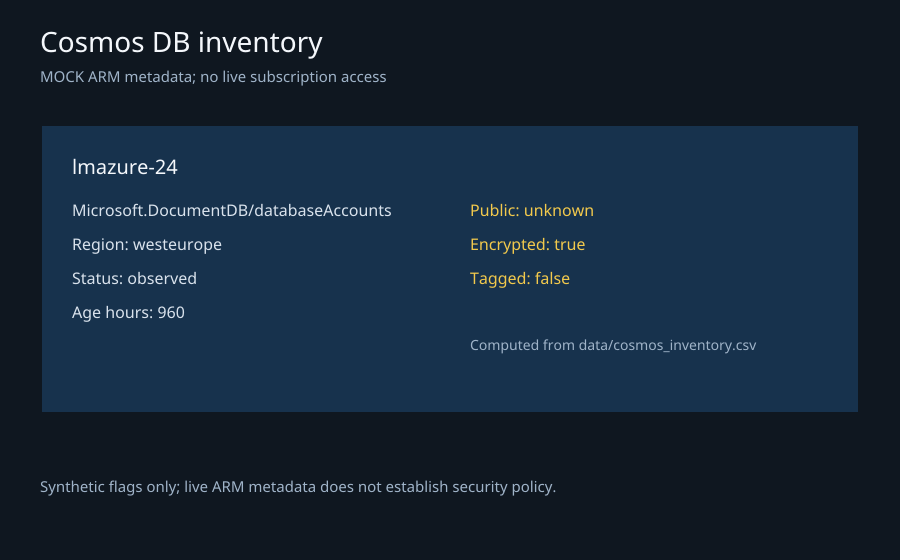 | **Cosmos DB** — running this example costs about $0.00 (estimated from price table, not yet measured live)<br>`lmctl https://raw.githubusercontent.com/lmctl-ai/lmazure/main/examples/cosmos_inventory.lms` |

### Compliance, coverage and uncertainty

| Picture | Example, estimate and autorun |
| --- | --- |
| 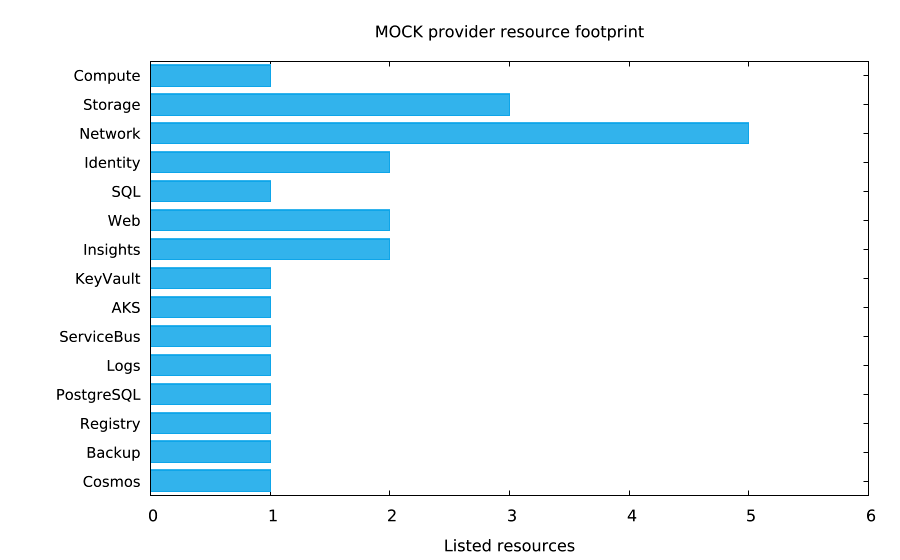 | **Provider footprint** — running this example costs about $0.00 (estimated from price table, not yet measured live)<br>`lmctl https://raw.githubusercontent.com/lmctl-ai/lmazure/main/examples/provider_footprint.lms` |
| 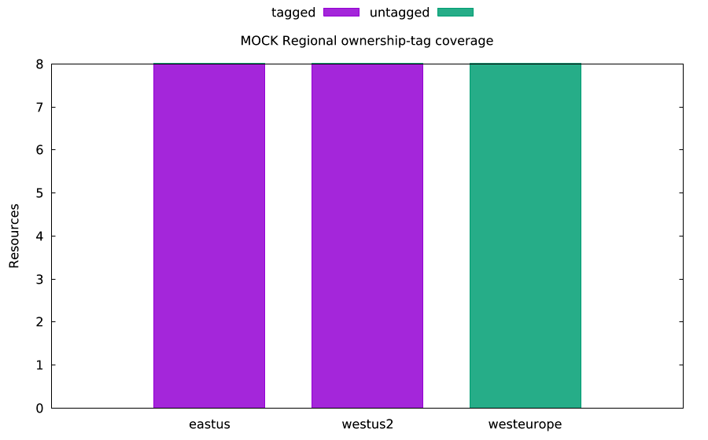 | **Regional ownership-tag coverage** — running this example costs about $0.00 (estimated from price table, not yet measured live)<br>`lmctl https://raw.githubusercontent.com/lmctl-ai/lmazure/main/examples/regional_tag_coverage.lms` |
| 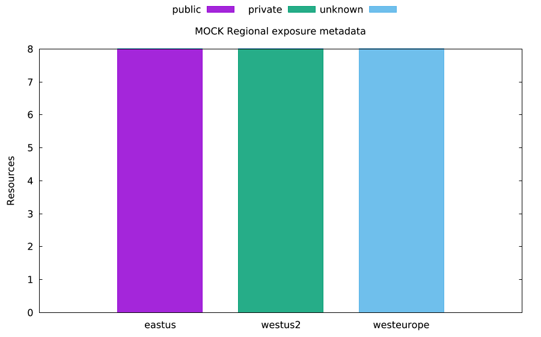 | **Regional exposure metadata** — running this example costs about $0.00 (estimated from price table, not yet measured live)<br>`lmctl https://raw.githubusercontent.com/lmctl-ai/lmazure/main/examples/public_surface_by_region.lms` |
| 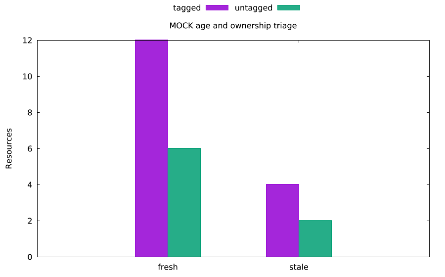 | **Age and ownership triage** — running this example costs about $0.00 (estimated from price table, not yet measured live)<br>`lmctl https://raw.githubusercontent.com/lmctl-ai/lmazure/main/examples/stale_ownership_triage.lms` |
| 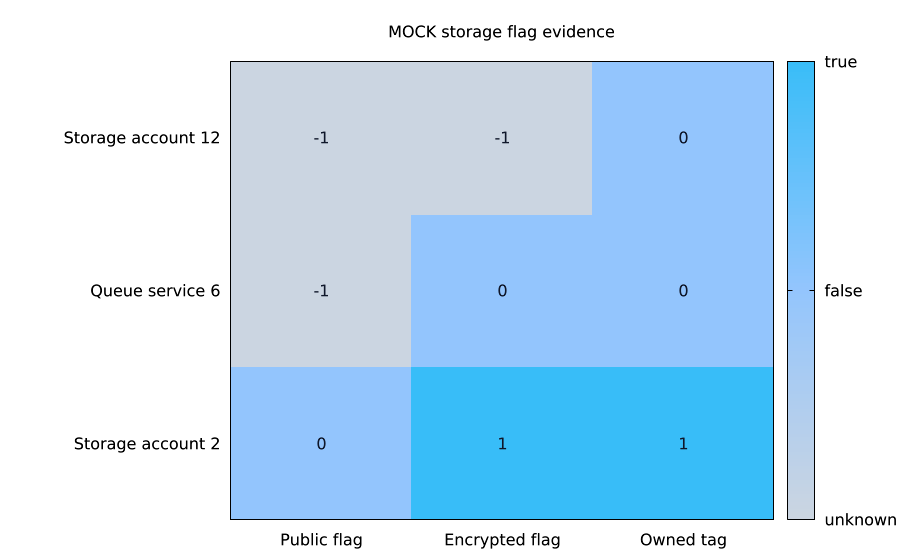 | **Storage flag evidence matrix** — running this example costs about $0.00 (estimated from price table, not yet measured live)<br>`lmctl https://raw.githubusercontent.com/lmctl-ai/lmazure/main/examples/storage_security_matrix.lms` |
| 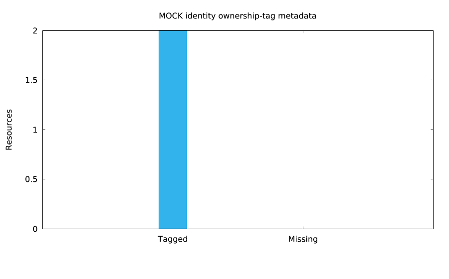 | **Identity ownership-tag metadata** — running this example costs about $0.00 (estimated from price table, not yet measured live)<br>`lmctl https://raw.githubusercontent.com/lmctl-ai/lmazure/main/examples/identity_tag_coverage.lms` |
|  | **Function-app regional metadata** — running this example costs about $0.00 (estimated from price table, not yet measured live)<br>`lmctl https://raw.githubusercontent.com/lmctl-ai/lmazure/main/examples/functions_region_coverage.lms` |
| 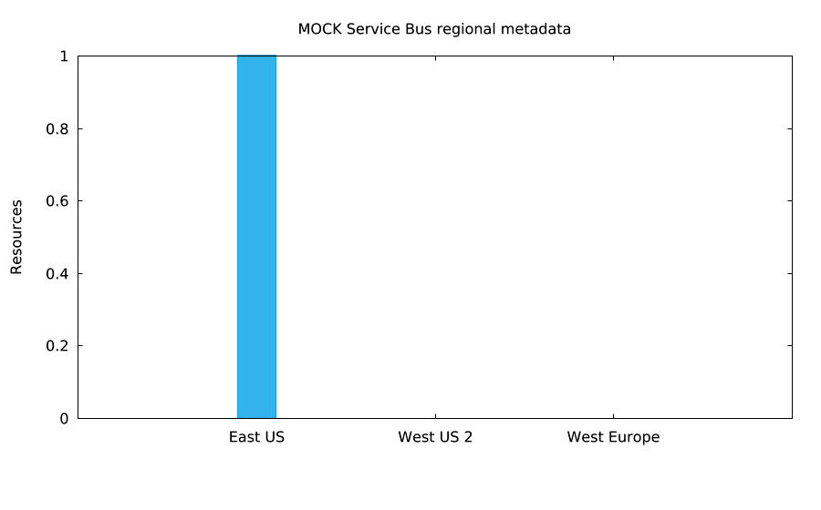 | **Service Bus regional metadata** — running this example costs about $0.00 (estimated from price table, not yet measured live)<br>`lmctl https://raw.githubusercontent.com/lmctl-ai/lmazure/main/examples/servicebus_region_coverage.lms` |
| 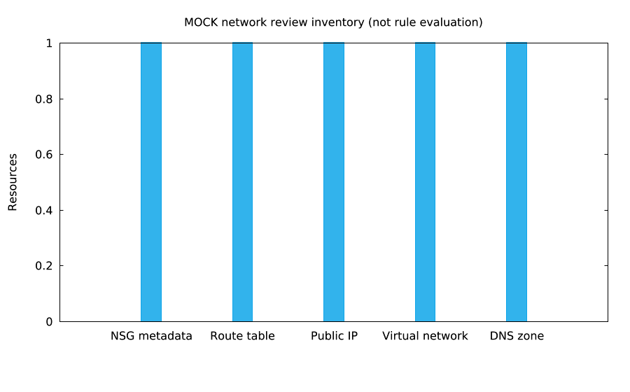 | **Network review inventory** — running this example costs about $0.00 (estimated from price table, not yet measured live)<br>`lmctl https://raw.githubusercontent.com/lmctl-ai/lmazure/main/examples/network_security_review.lms` |
| 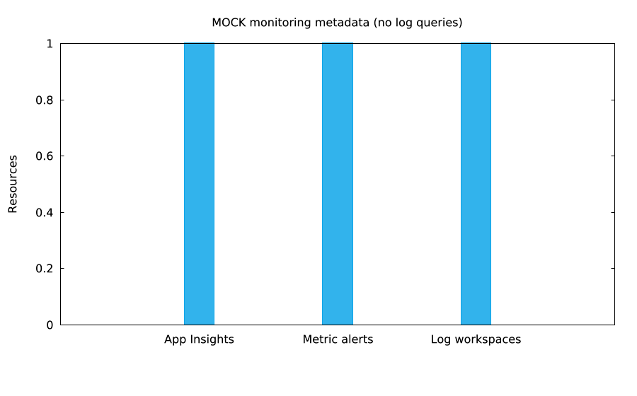 | **Monitoring metadata portfolio** — running this example costs about $0.00 (estimated from price table, not yet measured live)<br>`lmctl https://raw.githubusercontent.com/lmctl-ai/lmazure/main/examples/monitoring_coverage.lms` |
| 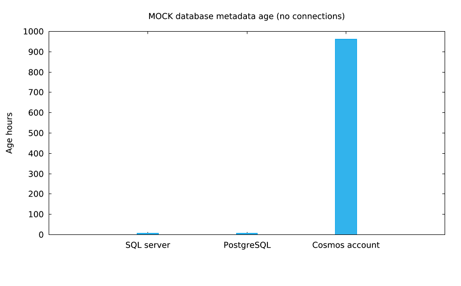 | **Database portfolio age** — running this example costs about $0.00 (estimated from price table, not yet measured live)<br>`lmctl https://raw.githubusercontent.com/lmctl-ai/lmazure/main/examples/database_portfolio.lms` |
| 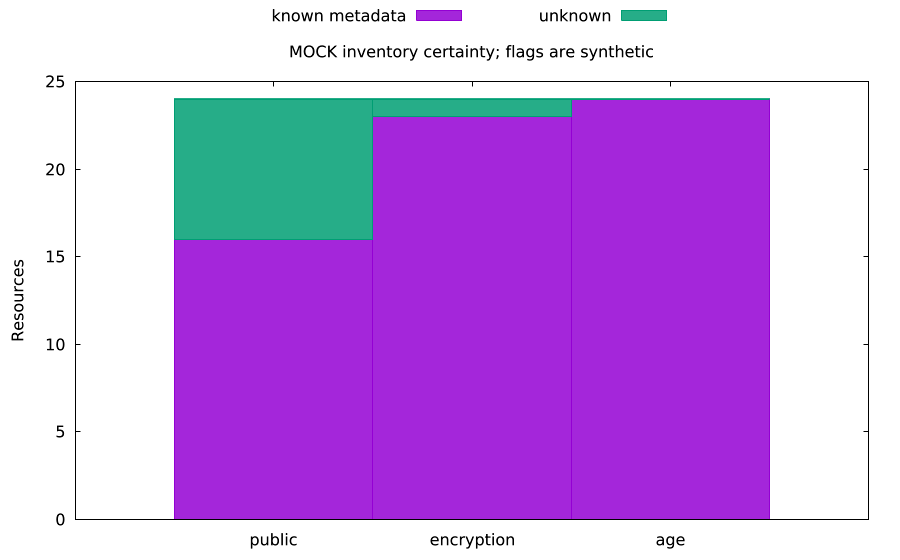 | **Inventory certainty audit** — running this example costs about $0.00 (estimated from price table, not yet measured live)<br>`lmctl https://raw.githubusercontent.com/lmctl-ai/lmazure/main/examples/inventory_unknowns_audit.lms` |

### Regional resource matrices

| Picture | Example, estimate and autorun |
| --- | --- |
| 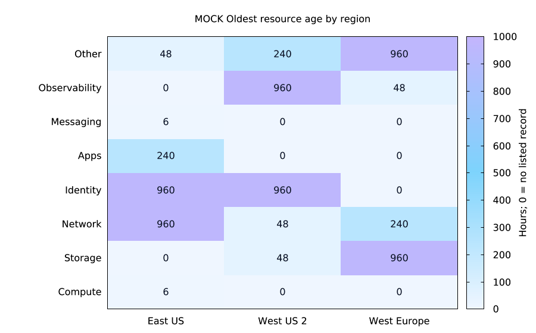 | **Oldest resource age by region** — running this example costs about $0.00 (estimated from price table, not yet measured live)<br>`lmctl https://raw.githubusercontent.com/lmctl-ai/lmazure/main/examples/resource_age_heatmap.lms` |
|  | **Service counts by region** — running this example costs about $0.00 (estimated from price table, not yet measured live)<br>`lmctl https://raw.githubusercontent.com/lmctl-ai/lmazure/main/examples/region_service_matrix.lms` |

### Resource grouping graphs

| Picture | Example, estimate and autorun |
| --- | --- |
| 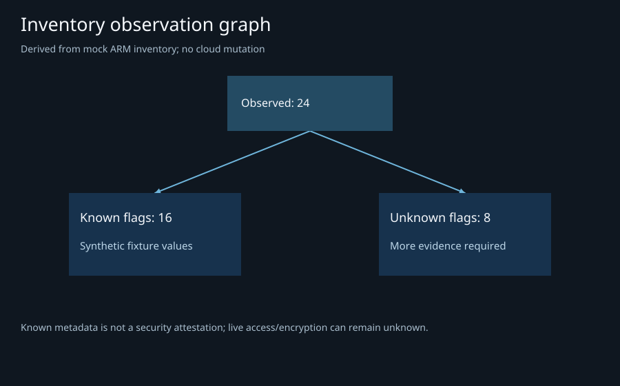 | **Inventory observation graph** — running this example costs about $0.00 (estimated from price table, not yet measured live)<br>`lmctl https://raw.githubusercontent.com/lmctl-ai/lmazure/main/examples/inventory_observation_graph.lms` |
| 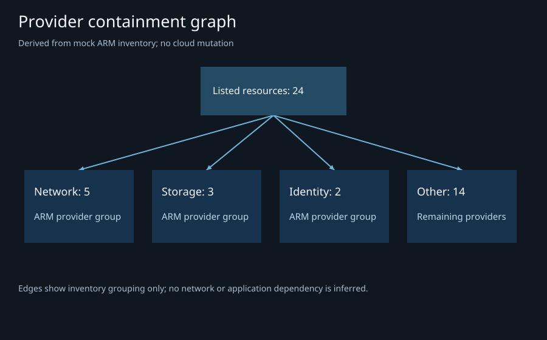 | **Provider containment graph** — running this example costs about $0.00 (estimated from price table, not yet measured live)<br>`lmctl https://raw.githubusercontent.com/lmctl-ai/lmazure/main/examples/provider_resource_graph.lms` |
|  | **Regional ownership graph** — running this example costs about $0.00 (estimated from price table, not yet measured live)<br>`lmctl https://raw.githubusercontent.com/lmctl-ai/lmazure/main/examples/regional_resource_graph.lms` |
| 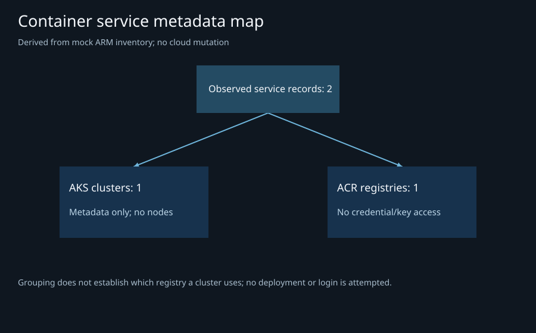 | **Container service metadata map** — running this example costs about $0.00 (estimated from price table, not yet measured live)<br>`lmctl https://raw.githubusercontent.com/lmctl-ai/lmazure/main/examples/container_registry_map.lms` |

### Owned resources, cleanup and cost controls

| Picture | Example, estimate and autorun |
| --- | --- |
|  | **Owned container cycle** — running this example costs about $0.0005 (estimated from price table, not yet measured live)<br>`lmctl https://raw.githubusercontent.com/lmctl-ai/lmazure/main/examples/owned_container_cycle.lms` |
| 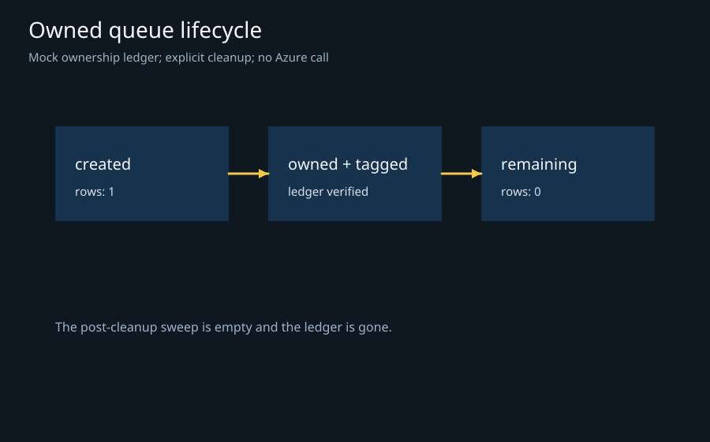 | **Owned queue cycle** — running this example costs about $0.0005 (estimated from price table, not yet measured live)<br>`lmctl https://raw.githubusercontent.com/lmctl-ai/lmazure/main/examples/owned_queue_cycle.lms` |
|  | **Owned Queue Tag Audit** — running this example costs about $0.0005 (estimated from price table, not yet measured live)<br>`lmctl https://raw.githubusercontent.com/lmctl-ai/lmazure/main/examples/owned_queue_tag_audit.lms` |
| 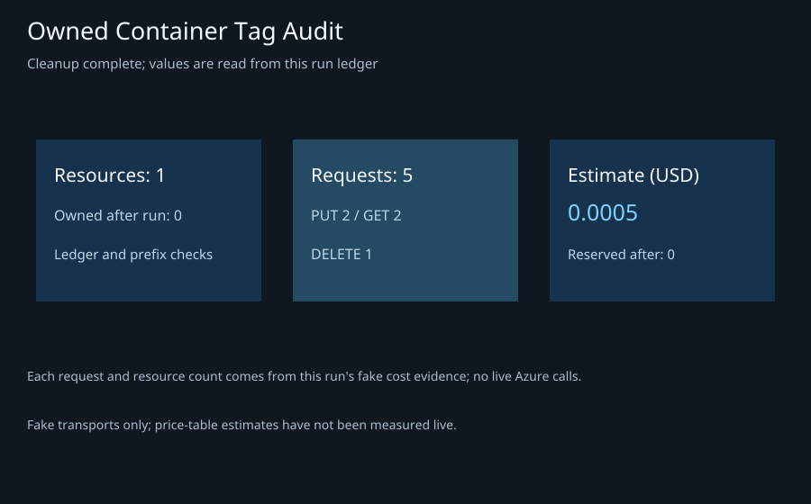 | **Owned Container Tag Audit** — running this example costs about $0.0005 (estimated from price table, not yet measured live)<br>`lmctl https://raw.githubusercontent.com/lmctl-ai/lmazure/main/examples/owned_container_tag_audit.lms` |
| 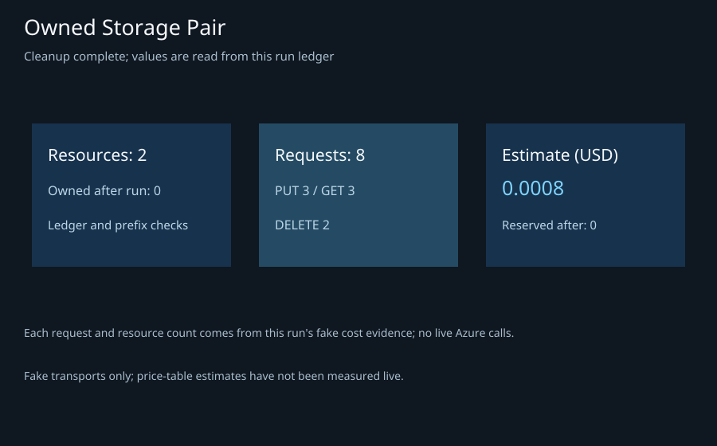 | **Owned Storage Pair** — running this example costs about $0.0008 (estimated from price table, not yet measured live)<br>`lmctl https://raw.githubusercontent.com/lmctl-ai/lmazure/main/examples/owned_storage_pair.lms` |
| 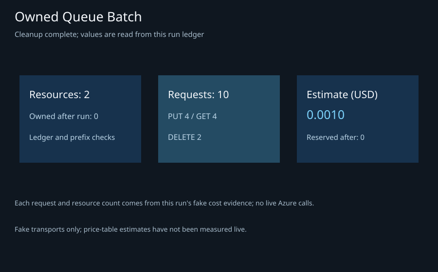 | **Owned Queue Batch** — running this example costs about $0.0010 (estimated from price table, not yet measured live)<br>`lmctl https://raw.githubusercontent.com/lmctl-ai/lmazure/main/examples/owned_queue_batch.lms` |
|  | **Owned Container Batch** — running this example costs about $0.0010 (estimated from price table, not yet measured live)<br>`lmctl https://raw.githubusercontent.com/lmctl-ai/lmazure/main/examples/owned_container_batch.lms` |
|  | **Owned Delete Then Cleanup** — running this example costs about $0.0005 (estimated from price table, not yet measured live)<br>`lmctl https://raw.githubusercontent.com/lmctl-ai/lmazure/main/examples/owned_delete_then_cleanup.lms` |
|  | **Owned Sweep Preview** — running this example costs about $0.0006 (estimated from price table, not yet measured live)<br>`lmctl https://raw.githubusercontent.com/lmctl-ai/lmazure/main/examples/owned_sweep_preview.lms` |
|  | **Owned Sweep Apply** — running this example costs about $0.0005 (estimated from price table, not yet measured live)<br>`lmctl https://raw.githubusercontent.com/lmctl-ai/lmazure/main/examples/owned_sweep_apply.lms` |
|  | **Owned Mixed Lifecycle** — running this example costs about $0.0010 (estimated from price table, not yet measured live)<br>`lmctl https://raw.githubusercontent.com/lmctl-ai/lmazure/main/examples/owned_mixed_lifecycle.lms` |
|  | **Owned Ownership Evidence** — running this example costs about $0.0005 (estimated from price table, not yet measured live)<br>`lmctl https://raw.githubusercontent.com/lmctl-ai/lmazure/main/examples/owned_ownership_evidence.lms` |
|  | **Owned Budget Admission** — running this example costs about $0.00 (estimated from price table, not yet measured live)<br>`lmctl https://raw.githubusercontent.com/lmctl-ai/lmazure/main/examples/owned_budget_admission.lms` |
|  | **Cleanup Age Guard** — running this example costs about $0.0005 (estimated from price table, not yet measured live)<br>`lmctl https://raw.githubusercontent.com/lmctl-ai/lmazure/main/examples/cleanup_age_guard.lms` |
|  | **Cleanup Candidate Graph** — running this example costs about $0.0006 (estimated from price table, not yet measured live)<br>`lmctl https://raw.githubusercontent.com/lmctl-ai/lmazure/main/examples/cleanup_candidate_graph.lms` |
|  | **Cost Request Breakdown** — running this example costs about $0.0005 (estimated from price table, not yet measured live)<br>`lmctl https://raw.githubusercontent.com/lmctl-ai/lmazure/main/examples/cost_request_breakdown.lms` |
|  | **Cost Teardown Reserve** — running this example costs about $0.0005 (estimated from price table, not yet measured live)<br>`lmctl https://raw.githubusercontent.com/lmctl-ai/lmazure/main/examples/cost_teardown_reserve.lms` |
